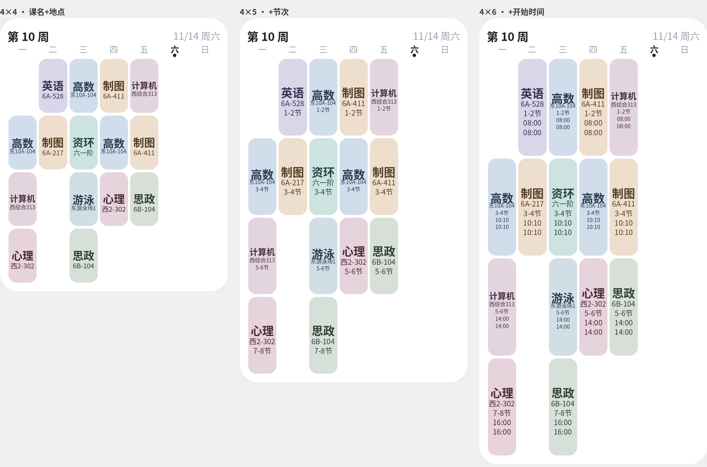

# Schedule

把 **任务、课表、精力** 放在同一条时间轴上的安卓日程应用。
离线优先，不注册、不联网、没有广告，数据只存在你自己的手机上。

<p align="center">
  
  
  
</p>

<p align="center">
  
</p>

---

## 关于名字

应用名是 **Schedule**，包名 `com.liu.dailycat` 是最早期起的（那时项目叫 dailycat），后来应用名改了但包名保留 ——
包名一改，系统就当成另一个 App，所有已安装用户的数据都会丢，所以这个不能动。仓库名曾用 daycat，现统一为 schedule。

## 它解决什么问题

普通的待办清单只告诉你「还有几件事没做」。它回答的是另一个问题：**今天到底塞不塞得下**。

每件事都有精力消耗，一天从 100 分开始，做完一件扣一点，剩下的就是今天的余量。计划排得太满，早上就能看出来，而不是到晚上才发现做不完。

## 功能

- **一条时间轴** — 任务、课程、空白时间都画在同一条线上，7:00 到 23:00 可以自己调
- **精力预算** — 每件事按「时长 + 优先级」算消耗，日历上每天的颜色就是那天的收工状态
- **课表导入** — 支持教务系统导出的 Excel（.xlsx / .xls / .csv），填一次开学第一周的日期，课程自动铺进每一周
- **三种任务** — 一次性 / 周期（每天、每周几、每月几号）/ 截止日；周期任务做完这一轮自己会回来
- **子任务** — 挂在一条任务下面逐项打勾，不占时间轴、不扣精力
- **多提醒** — 一个任务可以设多个提醒，支持自定义提前多少分钟（1–1440）
- **桌面小组件** — 一周课表纵览，三种固定尺寸（4×4 / 4×5 / 4×6），课名 + 教室一眼看清
- **自动排布** — 把没定时间的任务按优先级塞进未来 7 天的空档，可一键撤销
- **中英双语** — 界面随时切换

## 下载安装

到 [Releases](../../releases) 下载最新的 `Schedule.apk`，直接安装。

> **安装时提示「未备案」是正常的。** 那是手机厂商对未登记工信部备案的应用做的提示，不是病毒报警。个人开发的应用没有走备案流程，所以会弹。点「继续安装」即可。

**校验是不是官方包**（防止别人改包重发）：

```
SHA-256: 45:A0:B3:CD:A3:03:E0:49:2C:E1:1B:4E:DC:B8:80:28:E9:9D:11:9A:12:02:5F:F7:04:F1:03:9E:A2:4B:6F:A4
```

```bash
apksigner verify --print-certs Schedule.apk
```

## 从源码构建

不需要 Gradle。装好 JDK、Android SDK（build-tools 35.0.0 + platform android-33）就能直接出包：

```bash
export ANDROID_HOME=~/android-sdk
export KS=~/.daycat/release.jks     # 你自己的签名密钥（文件名随意）
export KS_PASS=你的密码
export KS_ALIAS=dailycat           # 可选，默认 dailycat（历史别名，不影响使用）

bash scripts/build_apk.sh
# 产物：Schedule.apk
```

没有密钥就先造一个（**生成后务必备份，丢了就无法给已有用户推送更新**）：

```bash
mkdir -p ~/.daycat
keytool -genkeypair -v -keystore ~/.daycat/release.jks -alias Schedule \
  -keyalg RSA -keysize 2048 -validity 10950 \
  -dname "CN=Your Name, O=Personal, C=CN"
```

项目结构：

```
app-src/            安卓壳（WebView）+ 全部 Java 源码
  src/com/liu/dailycat/
    MainActivity.java           WebView 宿主、JS 桥
    AlarmSync.java              闹钟登记（精确闹钟 / 闹钟式闹钟）
    Notifier.java               通知频道、发通知
    ReminderReceiver.java       到点广播
    BootReceiver.java           开机重登闹钟
    WidgetProvider.java         桌面小组件（Canvas 绘制）
    Widget45.java / Widget46.java   4×5 / 4×6 两个变体
    WidgetImageProvider.java    组件图片的 ContentProvider
  assets/www/index.html         整个前端（单文件：HTML + CSS + JS）
  res/                          图标、布局、小组件配置
scripts/
  build_apk.sh                  一键打包
  check_ids.py                  打包前检查 HTML 里 $() 绑定的 id 是否存在
  preview_widget.py             用 PIL 复刻组件绘制逻辑，出预览图
  selftest_widget.py            组件尺寸/排版的自测
```

界面逻辑全在 `app-src/assets/www/index.html` 这一个文件里（约 450KB），改界面只改它，然后复制到 `app-src/assets/www/`。

## 和 Planly 的关系

本项目 fork 自 [Planly](https://github.com/danil-kokorev/planly)（MIT），保留了它的时间轴、精力、周期任务、笔记等核心设计，在此基础上：

- 做了安卓原生壳（WebView + JS 桥：通知、闹钟、桌面组件）
- 补齐了完整中文界面（原项目以俄语/英语为主）
- 重写了提醒链路（精确闹钟权限、通知频道自愈）
- 新增课表导入、桌面一周课表小组件、单文件 HTML 打包

## 隐私

不注册、不联网、不收集任何数据。所有内容存在设备本地的 localStorage 里。
详见 [PRIVACY.md](PRIVACY.md)。

当前版本所有网络出入口都是关闭状态（`NET_ON = false`），预留了检查更新的位置，接上之后也只请求版本号，不上传任何内容。

## 已知限制

- 只在 Android 13/14 的国产 ROM（vivo）上实测过，其它机型未逐一验证
- 提醒准时依赖系统的「精确闹钟」权限，部分 ROM 还需把电池策略设为「不受限制」
- 桌面小组件是三个固定尺寸的独立组件，**不支持拉伸和滑动翻周**（点一下打开 App）
- 没有做工信部 App 备案，安装时会有系统提示

## 检查更新

App 启动 5 秒后自动查一次（24 小时内不重复），设置页也有「检查更新」可以手动点。
发现新版本会弹窗显示版本号、更新说明和「去下载」按钮，点了用系统浏览器打开下载页。

判断依据是 `version.json` 里的 `code` 和当前 `versionCode` 比较（不是比字符串）：

```json
{ "version": "2.0.1", "code": 115,
  "url": "https://github.com/<你>/<仓库>/releases/latest/download/Schedule.apk",
  "notes": "更新说明，换行用 \n" }
```

**两处地址要一起改**（改了仓库名或迁移了文件位置时）：

1. `app-src/src/com/liu/dailycat/MainActivity.java` 里的 `UPDATE_URL`
   —— 默认走 jsDelivr 镜像：`https://cdn.jsdelivr.net/gh/<你>/<仓库>@main/version.json`
2. 仓库根目录 `version.json` 的 `url` 字段 —— 建议用 `releases/latest/download/` 这种形式，永远指向最新版

请求由原生 `HttpURLConnection` 发出（不是 WebView 里的 fetch），所以没有跨域问题，
也不受前端 `NET_ON` 开关影响。只发一个 GET、不带任何用户数据。

## 开发日志

从 Planly 改到现在的完整过程，包括每一版踩过的坑和修法：[docs/DEVELOPMENT.md](docs/DEVELOPMENT.md)

## License

MIT，见 [LICENSE](LICENSE)。

用到 [SheetJS](https://sheetjs.com/) 解析 Excel（Apache-2.0）。
