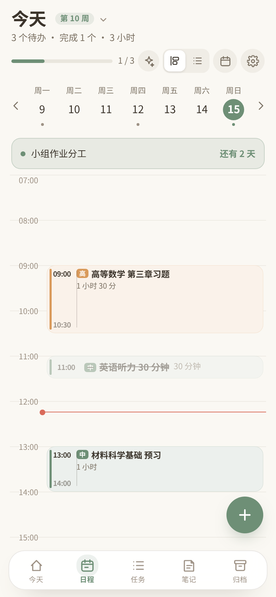
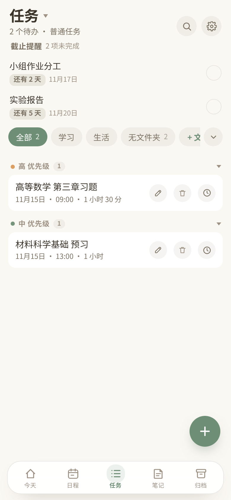

# Schedule

**告别臃肿的日程表 —— 极简、纯本地、无广告的日常打卡与时间管理应用。**

把 **任务、课表、精力** 放在同一条时间轴上的日程应用。
安卓装 APK，iPhone 用网页版（添加到主屏幕，不用装东西）。
离线优先，不注册、不联网，数据只存在你自己的手机上。

<p align="center">
  
  
  
</p>

<p align="center"><sub>今天 · 日程 · 任务</sub></p>

<p align="center">
  
</p>

<p align="center"><sub>桌面小组件，三种固定尺寸</sub></p>

---

## 它解决什么问题

普通的待办清单只告诉你「还有几件事没做」。它回答的是另一个问题：**今天到底塞不塞得下**。

每件事都有精力消耗，一天从 100 分开始，做完一件扣一点，剩下的就是今天的余量。计划排得太满，早上就能看出来，而不是到晚上才发现做不完。

## 功能

- **一条时间轴** — 任务、课程、空白时间都画在同一条线上，7:00 到 23:00 可以自己调
- **精力预算** — 每件事按「时长 + 优先级」算消耗，日历上每天的颜色就是那天的收工状态
- **课表导入** — 教务系统导出的 Excel（.xlsx / .xls / .csv）直接扔进来：网格课表、明细表都认；格里是「课名 / 周次 / 地点 / 教师」混着写、一格塞多门课、甚至文字被切到下一行都能拼回来；作息时间和开学日期能自动读出来
- **三种任务** — 一次性 / 周期（每天、每周几、每月几号）/ 截止日；周期任务做完这一轮自己会回来
- **子任务** — 挂在一条任务下面逐项打勾，不占时间轴、不扣精力
- **多提醒** — 一个任务可以设多个提醒，支持自定义提前多少分钟（1–1440）
- **桌面小组件** — 一周课表纵览，三种固定尺寸（4×4 / 4×5 / 4×6），课名 + 教室一眼看清
- **自动排布** — 把没定时间的任务按优先级塞进未来 7 天的空档，可一键撤销
- **中英双语** — 界面随时切换

## 下载安装

### 安卓

**直接下载：[Releases](../../releases) → `Schedule.apk` → 安装。就这三步。**

装完就是最新的，不用额外配置。下面这些是遇到问题才需要看的。

<details>
<summary>安装时提示「未备案」</summary>

那是手机厂商对未登记工信部备案的应用做的提示，不是病毒报警。个人开发的应用没有走备案流程，所以会弹。点「继续安装」即可。
</details>

<details>
<summary>校验是不是官方包（防止别人改包重发）</summary>

签名证书 SHA-256：

```
45:A0:B3:CD:A3:03:E0:49:2C:E1:1B:4E:DC:B8:80:28:E9:9D:11:9A:12:02:5F:F7:04:F1:03:9E:A2:4B:6F:A4
```

```bash
apksigner verify --print-certs Schedule.apk
```
</details>

<details>
<summary>从源码构建</summary>

不需要 Gradle。装好 JDK、Android SDK（build-tools 35.0.0 + platform android-33）就能直接出包：

```bash
export ANDROID_HOME=~/android-sdk
export KS=~/.daycat/release.jks     # 你自己的签名密钥（文件名随意）
export KS_PASS=你的密码
export KS_ALIAS=dailycat           # 可选，默认 dailycat（历史别名，不影响使用）

bash scripts/build_apk.sh
# 产物：Schedule.apk
```

没有密钥就先造一个（**生成后务必备份，丢了就无法给已有用户推送更新**）：

```bash
mkdir -p ~/.daycat
keytool -genkeypair -v -keystore ~/.daycat/release.jks -alias Schedule \
  -keyalg RSA -keysize 2048 -validity 10950 \
  -dname "CN=Your Name, O=Personal, C=CN"
```

项目结构：

```
app-src/            安卓壳（WebView）+ 全部 Java 源码
  src/com/liu/dailycat/
    MainActivity.java           WebView 宿主、JS 桥
    AlarmSync.java              闹钟登记（精确闹钟 / 闹钟式闹钟）
    Notifier.java               通知频道、发通知
    ReminderReceiver.java       到点广播
    BootReceiver.java           开机重登闹钟
    WidgetProvider.java         桌面小组件（Canvas 绘制）
    Widget45.java / Widget46.java   4×5 / 4×6 两个变体
    WidgetImageProvider.java    组件图片的 ContentProvider
  assets/www/index.html         整个前端（单文件：HTML + CSS + JS）
  res/                          图标、布局、小组件配置
docs/
  index.html                    网页版（内容与 assets/www 相同，供 GitHub Pages 使用）
scripts/
  build_apk.sh                  一键打包
  check_ids.py                  打包前检查 HTML 里 $() 绑定的 id 是否存在
  preview_widget.py             用 PIL 复刻组件绘制逻辑，出预览图
  selftest_widget.py            组件尺寸/排版的自测
```

界面逻辑全在 `app-src/assets/www/index.html` 这一个文件里，改界面只改它，然后同步到 `docs/index.html`（两个位置分别是安卓包和网页版的内容，必须保持一致）。
</details>

### iPhone

**不用装 App。用 Safari 打开，加到主屏幕就能用。**

1. Safari 打开 <https://streamfish-lab.github.io/daycat/>
   （微信里打不开，点右上角 `···` → 在浏览器打开）
2. 点底部中间的**分享**按钮
3. 往下滑，选**添加到主屏幕**，点「添加」

之后从主屏幕那个图标进，全屏、无地址栏、断网也能用。

<details>
<summary>iPhone 和安卓有什么区别</summary>

| | 安卓 App | iPhone 网页版 |
|---|---|---|
| 界面、数据保存、断网使用 | 一样 | 一样 |
| 到点提醒 | 系统精确闹钟，锁屏也响 | 要导出到系统日历 |
| 桌面小组件 | 有 | 没有 |
| 自动备份 | 每周自动 | 手动导出 |
| 版本更新 | 弹窗提示 | 打开时自动更新 |

让 iPhone 能准时提醒：设置 → 导出到系统日历 → 点开下载的 `Schedule.ics` → 添加到日历。

**注意**：别删主屏幕那个图标，删图标等于把数据一起删掉（iOS 的机制）。换设备前先在设置里导出备份。
</details>

## 隐私

不注册、无账号、不收集任何数据。所有内容存在设备本地的 localStorage 里。
详见 [PRIVACY.md](PRIVACY.md)。

唯一的网络请求是「检查更新」：一个只读 GET，取回 `version.json` 里的版本号，不带任何用户数据、不上传任何内容。除此之外应用完全离线运行。

## 已知限制

- 只在 Android 13/14 的国产 ROM（vivo）上实测过，其它机型未逐一验证
- 提醒准时依赖系统的「精确闹钟」权限，部分 ROM 还需把电池策略设为「不受限制」
- 桌面小组件是三个固定尺寸的独立组件，**不支持拉伸和滑动翻周**（点一下打开 App）
- **iPhone 网页版没有后台提醒、没有小组件、没有自动备份**，提醒需导出到系统日历
- 没有做工信部 App 备案，安装时会有系统提示
- 课表格式只覆盖了目前收到的几种（网格表 / 明细表 / 转置表 / `{第1-16周` / `@` / 字段式）。遇到导不进的，把文件发给作者，比截图有用得多

<details>
<summary>检查更新的机制</summary>

自动检查的时机：**启动后 8 秒**、**每次应用回到前台**、以及运行中**每 2 小时**各看一眼；
查通一次之后 6 小时内不再重复。查询失败不占用冷却，20 分钟后就会重试。

发现新版本时，首页底部会出现一条常驻提示条（可点 × 关闭）；设置页的「检查更新」也能手动触发。

**下载不跳浏览器**：点「下载并安装」由应用自己下载（带进度条），下完自动拉起系统安装器。
下载有多条线路，一条不通自动换下一条：

```
gh-proxy 加速 → GitHub 直链 → ghproxy 备用
```

全部不通时，面板上还有「用浏览器打开」和「复制下载链接」两个兜底。

判断依据是 `version.json` 里的 `code` 和当前 `versionCode` 比较（不是比字符串）：

```json
{
  "version": "2.0.44",
  "code": 158,
  "url": "https://gh-proxy.com/https://github.com/<你>/<仓库>/releases/latest/download/Schedule.apk",
  "mirrors": [
    "https://github.com/<你>/<仓库>/releases/latest/download/Schedule.apk",
    "https://ghproxy.net/https://github.com/<你>/<仓库>/releases/latest/download/Schedule.apk"
  ],
  "notes": "更新说明，换行用 \n"
}
```

> `url` 是主线路，`mirrors` 是可选的备用线路数组，按顺序挨个试。
> 如果其中写的是 `https://github.com/...`，前端会自动再套一层 `gh-proxy.com`
> 和 `ghproxy.net` 做备份，所以不写这两个前缀也行。

**为什么要用 gh-proxy 包一层**：GitHub Release 真正的下载域名是
`objects.githubusercontent.com`，国内经常连不上。直接给用户原始的 github.com 链接，
十有八九是打开一片白屏。

**版本文件本身的地址**放在 `MainActivity.java` 的 `UPDATE_URLS` 数组里，
依次是 jsDelivr、fastly.jsdelivr、raw.githubusercontent，一个不通换下一个。
换了仓库名要跟着改这里。

>>> 发布新版时，**仓库根目录的 `version.json` 必须一起更新，且 `code` 要等于新 APK 的
`versionCode`**。这一步漏了，所有用户都收不到更新提醒。

请求由原生 `HttpURLConnection` 发出（不是 WebView 里的 fetch），所以没有跨域问题，
也不受前端 `NET_ON` 开关影响。只发一个 GET、不带任何用户数据。
</details>

## 关于名字

应用名是 **Schedule**，包名 `com.liu.dailycat` 是最早期起的（那时项目叫 dailycat），后来应用名改了但包名保留 ——
包名一改，系统就当成另一个 App，所有已安装用户的数据都会丢，所以这个不能动。仓库地址和下载链接里的 `daycat` 是同一时期留下的，同样保持不变。

## 和 Planly 的关系

本项目 fork 自 [Planly](https://github.com/danil-kokorev/planly)（MIT），保留了它的时间轴、精力、周期任务、笔记等核心设计，在此基础上：

- 做了安卓原生壳（WebView + JS 桥：通知、闹钟、桌面组件）
- 补齐了完整中文界面（原项目以俄语/英语为主）
- 重写了提醒链路（精确闹钟权限、通知频道自愈）
- 新增课表导入、桌面一周课表小组件、单文件 HTML 打包
- 加了网页版，iPhone 可以添加到主屏幕直接用

## 开发日志

从 Planly 改到现在的完整过程，包括每一版踩过的坑和修法：[docs/DEVELOPMENT.md](docs/DEVELOPMENT.md)

## License

MIT，见 [LICENSE](LICENSE)。

用到 [SheetJS](https://sheetjs.com/) 解析 Excel（Apache-2.0）。
